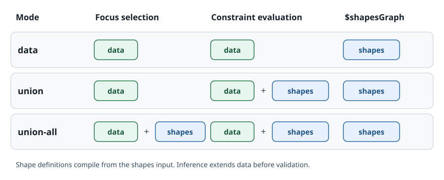

Graph inputs and evaluation
===========================

.. _shapes-and-data-graphs:

The graph inputs determine where shape definitions come from. ``graph_mode``
controls the triples visible during validation. Inference runs before
validation and can add triples to the data graph.

Where shapes come from
----------------------

With a single graph, Shifty reads both shape definitions and data from it.
This supports combined files, where ``sh:NodeShape`` definitions sit alongside
instance data.

With separate shapes and data inputs, Shifty compiles the schema only from
the shapes graph. SHACL vocabulary in the data graph, such as ``sh:property``
or ``sh:NodeShape``, does not contribute constraints.

.. list-table::
   :widths: 45 25 30
   :header-rows: 1

   * - Invocation
     - Shapes read from
     - Data read from
   * - ``shifty.validate(combined)`` / ``shifty.validate(combined, None)``
     - the one graph
     - the one graph
   * - ``shifty.validate(data, shapes)``
     - ``shapes`` only
     - ``data`` only
   * - ``shifty validate --shapes combined.ttl``
     - the one graph
     - the one graph
   * - ``shifty validate --shapes shapes.ttl --data data.ttl``
     - ``--shapes`` only
     - ``--data`` only

This keeps the schema fixed when data changes, even if the data contains
SHACL definitions copied from another source.

Shapes embedded in data
~~~~~~~~~~~~~~~~~~~~~~~

Both ``--shapes`` and the Python ``shapes`` argument accept multiple sources
and union them. To include shapes embedded in data, add the data file as a
shapes input:

.. code-block:: bash

   shifty validate --shapes shapes.ttl --shapes data.ttl --data data.ttl

.. code-block:: python

   conforms, report, text = shifty.validate(data, [shapes, data])

An explicitly supplied shapes graph with zero triples raises ``ValueError``.
A nonempty schema whose targets select no focus nodes yields a conforming run.

Which triples are visible
-------------------------

``graph_mode`` (``--graph-mode`` on the CLI) controls focus selection and the
triples available to paths, class-hierarchy lookup, and SPARQL.

   Graph visibility with separate shapes and data inputs. Inference extends the
   data side before validation; ``$shapesGraph`` keeps naming the shapes source.

.. list-table::
   :widths: 20 35 45
   :header-rows: 1

   * - Mode
     - Focus selection
     - Evaluation graph
   * - ``data``
     - Data
     - Data
   * - ``union`` *(default)*
     - Data
     - Data ∪ shapes
   * - ``union-all``
     - Data ∪ shapes
     - Data ∪ shapes

The default, ``union``, makes ontology axioms in the shapes graph available
when checking data. For example, ``sh:class ex:Sensor`` can accept an
``ex:TemperatureSensor`` when the shapes graph declares that subclass relation.

Use ``data`` to check a self-contained data graph. Use ``union-all`` when the
shapes graph also contains instances you want to validate. It can also select
ontology resources as targets.

Adding visible triples can change a result in either direction. It may
satisfy a missing-value constraint, exceed ``sh:maxCount``, or add a predicate
that ``sh:closed`` forbids.

Inference before validation
---------------------------

By default, SHACL-AF rules run until no new triples are derived, then
validation checks the extended data. With separate inputs, rules can read
data and shapes while selecting focus nodes from data. With combined input,
rules read the evolving data graph. ``infer()`` takes no ``graph_mode`` option.

Pass ``infer=False`` or ``--no-infer`` to validate asserted data alone. See
:doc:`../how-to/infer` to retrieve or retain inferred triples.

SPARQL ``$shapesGraph`` always names the original shapes source. It does not
grow when inference adds data triples, even when one input file supplies both
shapes and data. To change the named shapes graph, compile a new shapes source.

.. _recursive-shapes:

Recursive shapes
----------------

Shape references can form cycles. SHACL 1.0 leaves their meaning undefined.
During Shifty validation, a cycle can conform if no reachable constraint
violation rules it out. Two named people who know each other can satisfy a
shape requiring each person and everyone they know to have a name. Removing
either name causes the relevant checks to fail. This is greatest fixed-point
validation.

Cycles through negation are rejected. Qualified cardinality can also
introduce a negative dependency. Use :ref:`inspect-validation` to inspect a
rejected schema.

Inference uses a least fixed point, deriving facts from asserted or previously
derived facts. It finishes before validation begins.

A recursive success can end in a ``coinductive`` evidence leaf. Such a leaf
provides no finite set of triples to delete, so deletion-based repair may be
blocked. The `evaluation design notes
<https://github.com/gtfierro/shifty/blob/main/development_docs/evaluation.md>`_
describe the algorithms.
